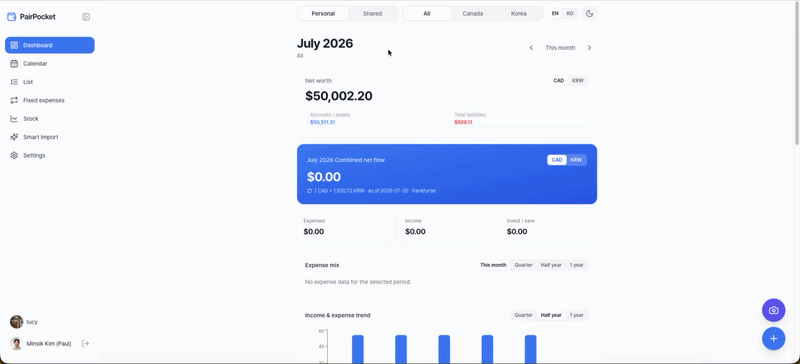
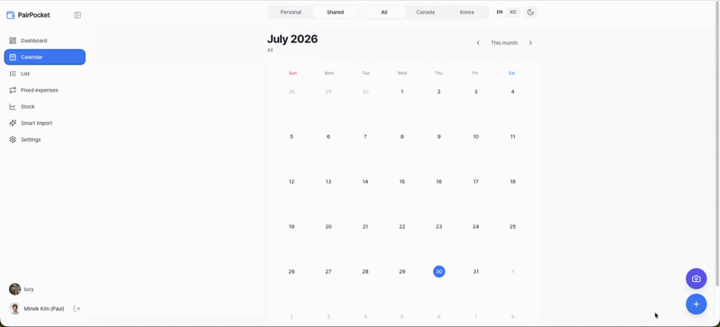
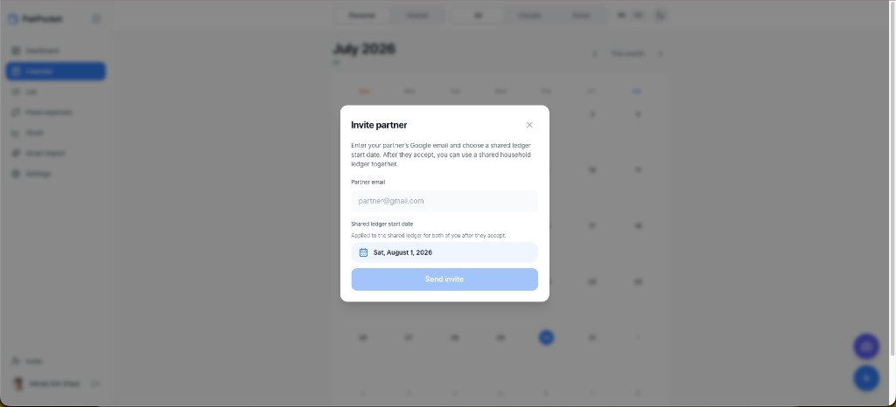
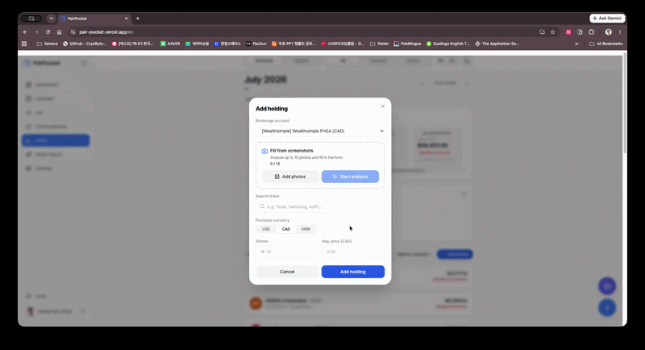
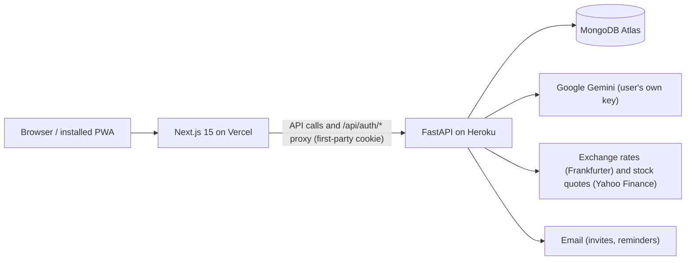

# PairPocket

> "A budget is telling your money where to go instead of wondering where it went."
> (John C. Maxwell)

[](https://www.pairpocket.me/en)
[](https://github.com/minsikpaul92/pair-pocket/actions/workflows/ci.yml)
[](https://buymeacoffee.com/minsikpaul92)

PairPocket is a household ledger for couples who share some money and keep some apart, and who may live across two currencies. Each person has a private personal ledger, and partners can link a shared ledger on top. It handles CAD and KRW side by side, tracks subscriptions and stocks, and uses AI to turn receipts and statements into entries.

**Try it:** [www.pairpocket.me](https://www.pairpocket.me/en) (sign in with Google)

**Landing page:** [minsikpaul92.github.io/pair-pocket](https://minsikpaul92.github.io/pair-pocket/) (English and Korean, source in [`site/`](site/))

## Why I built it

I immigrated to Canada and still hold money in more than one country. Most money apps are built for one market, or they treat a couple as one person. I wanted mine, yours and ours in one place, in two currencies, without my private entries showing up in my partner's view. I could not find that, so I built it end to end and run it as a production PWA.

You do not need a partner or a second currency to use it. A solo user gets a full personal ledger, with subscriptions and stocks included.

## What it does

- **Personal and shared ledgers.** Switch between your own book and the shared one. Shared records belong to the partnership that created them, so unlinking and linking a new partner never exposes the earlier shared history.
- **Two currencies.** Canada (CAD) and Korea (KRW) ledgers, plus a combined view with exchange rates.
- **Calendar, list and dashboard.** Monthly calendar, a merchant-first list with notes, and a dashboard with a monthly budget, a card for each country, net worth and a weekly expense mix.
- **Settlement.** Settle a shared expense with money from a personal account, or the other way around. Both sides are written together and stay consistent.
- **Subscriptions and fixed bills.** Schedules with promo pricing, skipped payments, installments, reminder emails, and moving an item between personal and shared.
- **Stocks.** Holdings per brokerage account with Yahoo Finance quotes and currency conversion.
- **Smart import.** Receipt photos, card-statement PDFs and CSV files become reviewable entries. CSV export has account and month filters.
- **Partner invite.** Invite by email with a shared ledger start date so both sides line up from day one.
- **Notifications and What's New.** A bell tells you when your partner adds a shared entry, and a list of release notes shows what changed.
- **Mobile first.** Installable PWA, light, dark and system themes, safe-area aware layout.
- **Korean and English.** Every screen is available in both. The language picker lists more languages that are still in beta.

## What makes it different

- **It records the story behind the money.** A bank statement shows money moving, often under a code or a vague merchant name that nobody remembers six months later. PairPocket lets you record the flow itself: settlements between partners, moves between accounts, credit card payments, and money going between the personal and shared ledgers. Months later you can still see what happened and why.
- **Moves do not pollute your charts.** Account transfers and card payments stay in the history but are not counted as spending, and settlements are netted against the expense they settle. Spending charts show what you actually spent, not the same money counted twice.
- **Free, with no bank connection on purpose.** Bank aggregation is a paid service, and a free app cannot honestly offer it. PairPocket takes manual entry plus receipt photos, statement PDFs and CSV imports instead, and has no ads.
- **AI is optional and costs you nothing.** Scanning and statement parsing use your own Gemini API key, which you can create with any Google account (subject to Google's current free-tier terms). Manual entry and CSV import work without a key.
- **No passwords to leak.** You sign in with Google, so PairPocket never stores a password. Your ledger data is still stored in the service database.

## Demo

### Personal and shared toggle



### Add a transaction



### Invite a partner



### AI screenshot fill



## How it is built



| Layer | Stack |
| --- | --- |
| Frontend | Next.js 15 (App Router), React 18, TypeScript, Tailwind CSS, next-intl, PWA via `@ducanh2912/next-pwa` |
| Backend | FastAPI, Pydantic, Motor (async MongoDB driver), Authlib, PyJWT |
| Data | MongoDB Atlas |
| AI | Google Gemini with a model fallback chain, using each user's own API key |
| Hosting | Vercel (frontend), Heroku (API) |

### Engineering notes

- **Ledger isolation.** Ledger reads go through shared access helpers that scope them to the user or to the partnership group, and fail closed when a shared row has no verified group. Shared rows carry the group ID that created them, unlinking archives the group, and legacy rows were migrated with a dry run and a backup. Merchant and institution suggestions follow the selected ledger, so a partner's personal history never leaks into shared autocomplete.
- **Atomic paired writes.** Personal and shared transfers, cross-ledger settlements and partnership changes run inside MongoDB transactions. A failed second write rolls back the whole pair. Settlements lock the expense they settle, so concurrent settlements cannot exceed it.
- **Sessions.** Short-lived access tokens with a rotating, revocable refresh cookie (HttpOnly, 30 days). Presenting an already rotated refresh credential revokes the whole session family, apart from a short grace window for two tabs refreshing at once. The frontend proxies the session routes through its own origin so the cookie stays first-party even though the API is on another domain.
- **AI import you can trust.** Gemini output is treated as a draft: prompts are tuned so tickers, amounts and dates are not invented, results go through a review screen, and the user's key is encrypted at rest.
- **Internationalization.** Strings live in `ko.json` and `en.json`, and CI fails when the two drift apart or new hardcoded Korean appears. What a screen shows never depends on the language; layout rules are in [`docs/i18n-and-layout.md`](docs/i18n-and-layout.md).
- **Tests and CI.** GitHub Actions runs frontend lint, the i18n check and a production build, and the backend pytest suite, on every pull request. The tests cover authorization, partnership scope, paired writes, settlement, sessions, notifications and account defaults.

## Run it locally

You need Node 18 or newer (CI uses 22), Python 3.12 (what CI and Heroku run), and a MongoDB connection string. Replica set mode is needed for the transaction-backed features.

### Backend

```bash
cd backend
python3 -m venv .venv
source .venv/bin/activate        # Windows: .venv\Scripts\activate
pip install -r requirements.txt
cp .env.example .env             # then edit with MongoDB and Google OAuth values
uvicorn app.main:app --reload
```

API docs are at http://localhost:8000/docs.

### Frontend

```bash
cd frontend
npm install
cp .env.example .env.local       # NEXT_PUBLIC_API_BASE_URL points at the backend
npm run dev
```

The app is at http://localhost:3000. The PWA is disabled in development; use `npm run build && npm run start` to test installability.

### Checks

```bash
cd frontend && npm run lint && npm run check:i18n && npm run build
cd backend && PYTHONPATH=. pytest -q
```

### Environment variables

| Location | Variable | Description |
| --- | --- | --- |
| `backend/.env` | `MONGODB_URI` | MongoDB connection string |
| `backend/.env` | `MONGODB_DB_NAME` | Database name (default `pairpocket`) |
| `backend/.env` | `CORS_ORIGINS` | Comma-separated allowed frontend origins |
| `backend/.env` | `SECRET_KEY` | JWT and OAuth session secret |
| `backend/.env` | `GOOGLE_CLIENT_ID` / `GOOGLE_CLIENT_SECRET` | Google OAuth 2.0 credentials |
| `backend/.env` | `OAUTH_REDIRECT_URI` | Must match the URI registered in Google Cloud |
| `backend/.env` | `FRONTEND_URL` | Post-login redirect target |
| `frontend/.env.local` | `NEXT_PUBLIC_API_BASE_URL` | FastAPI base URL |

### Google sign-in setup

Sign-in is backend-driven (authorization code flow through Authlib).

1. In [Google Cloud Console](https://console.cloud.google.com/), create a project and an OAuth consent screen (External). Add yourself as a test user while the app is unpublished.
2. Create an OAuth client ID (Web application) with the redirect URI `http://localhost:8000/api/auth/callback`.
3. Put the client ID and secret in `backend/.env` and set `OAUTH_REDIRECT_URI` and `FRONTEND_URL=http://localhost:3000`.
4. Generate a secret: `python -c "import secrets; print(secrets.token_hex(32))"`.

Auth endpoints: `GET /api/auth/login`, `GET /api/auth/callback`, `POST /api/auth/session` (redeem a one-time code, set the refresh cookie), `POST /api/auth/refresh`, `POST /api/auth/logout`, `GET /api/auth/me`.

## More documentation

- [`PRD.md`](./PRD.md) for product requirements and [`design.md`](./design.md) for the design language.
- [`docs/ROADMAP.md`](docs/ROADMAP.md) for what is shipped and what is planned.
- [`docs/i18n-and-layout.md`](docs/i18n-and-layout.md) for language and layout rules.
- [`site/README.md`](site/README.md) for the landing page (copy, languages, links, recordings, deploy).

## Support

If PairPocket saves you time, you can [buy me a coffee](https://buymeacoffee.com/minsikpaul92). It is optional, and there are no ads in the app.

## License

See [LICENSE](./LICENSE).
